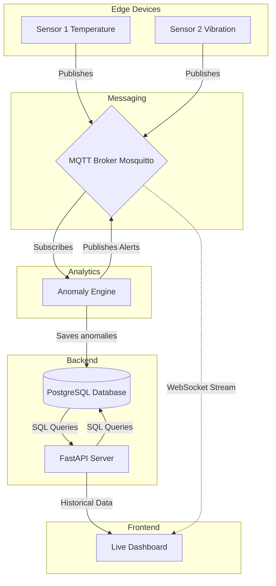

# IoT Anomaly Detection System - Conceptual Architecture

This document outlines the **Logical Architecture** and **Data Flow** of the project. It illustrates how raw data from edge devices moves through the messaging layer, gets analyzed by machine learning, is stored persistently, and finally rendered on the user's dashboard.

## System Diagram

---

## The 4-Tier Architecture Concept

### 1. Edge Layer (Data Generation)
In a real-world scenario, these are physical IoT devices (like ESP32 or Raspberry Pi) hooked up to industrial equipment. In our project, they are containerized Python scripts generating synthetic floating-point numbers. They act strictly as **Producers**.

### 2. Messaging Layer (The Nervous System)
We use the **Publish-Subscribe (Pub/Sub)** pattern instead of traditional HTTP requests. Why? Because HTTP is too heavy for IoT devices sending data every millisecond. The MQTT broker routes thousands of messages per second efficiently without needing to know *who* is sending or *who* is receiving.

### 3. Analytics & Storage Layer (The Brain & Memory)
- **Analytics:** The Processing Engine acts as a **Subscriber** (listening to raw data) and a **Producer** (broadcasting alerts). It maintains a sliding window of recent data in memory and applies an Unsupervised Machine Learning model (Isolation Forest) to detect outliers.
- **Storage:** Only the critical events (anomalies) are saved to the relational database (PostgreSQL) to save storage space and preserve system auditability.

### 4. Presentation Layer (The Observer)
The dashboard uses a dual-connection strategy:
1. **REST API (HTTP):** Used once on page-load to fetch historical anomalies from the FastAPI server.
2. **WebSockets (TCP):** Used continuously to listen to the MQTT broker for real-time telemetry and instant alert flashes. This avoids the need for the browser to constantly refresh or "poll" the server.
